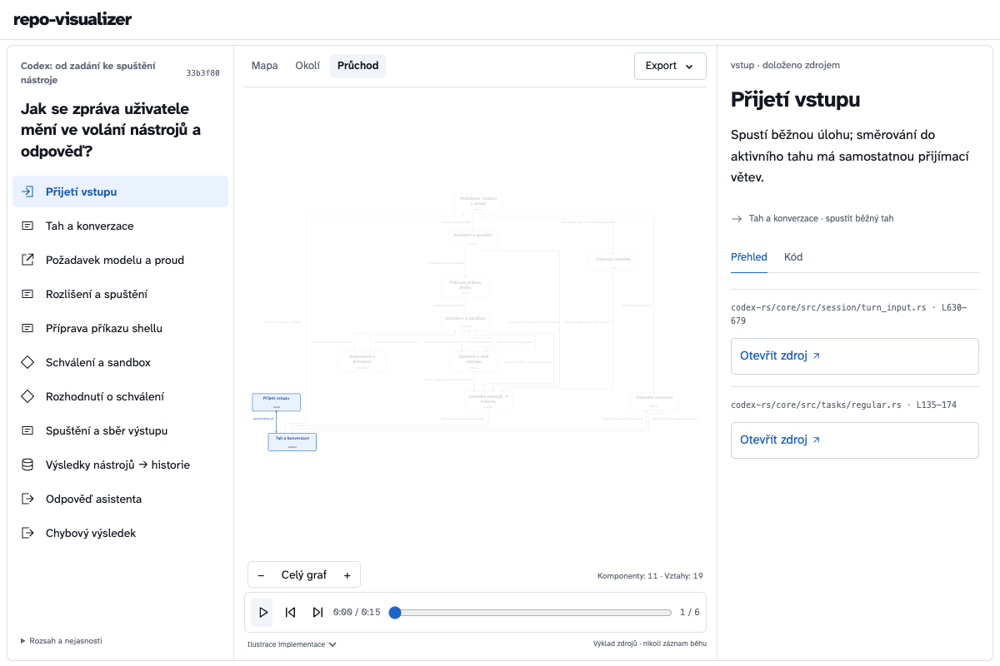

<div align="center">


# Repo Visualizer

Zeptejte se na kód. Prozkoumejte odpověď.

Otevřený skill pro **Codex** a **Claude Code**. Z otázky nad repozitářem vytvoří interaktivní graf komponent, odkazy do kódu a animaci.

[**Živá ukázka**](https://honzacuhel.github.io/repo-visualizer/?lang=cs) · [Instalace](#rychlý-start) · [Stažení](https://github.com/HonzaCuhel/repo-visualizer/releases)

[English](README.md) · Česky

</div>

<picture>
  <source media="(prefers-color-scheme: dark)" srcset="site/media/walkthrough-cs-dark.gif">
  
</picture>

**V ukázce Codex vysvětluje Codex.** Čerstvá relace Codex CLI pomocí nainstalovaného skillu vytvořila 11 komponent, 19 vazeb a 37 odkazů na konkrétní revizi zdrojů. Otevřete [celou agentní smyčku](https://honzacuhel.github.io/repo-visualizer/codex-agent-loop.html?lang=cs), vyberte komponentu a přečtěte si její kód. [Zdroj a záznam testu](examples/codex/README.md).

<a id="instalace"></a>

## Rychlý start

Spusťte uvnitř repozitáře, který chcete pochopit:

```sh
npx skills add HonzaCuhel/repo-visualizer --skill repo-visualizer -a codex -a claude-code
```

Pak požádejte agenta:

> Pomocí repo-visualizer vysvětli, jak tato funkce funguje. Zahrň komponenty, větvení a chybové cesty s odkazy do kódu. Exportuj interaktivní HTML graf a krátký GIF.

Pro jednoho agenta ponechte jen jeho `-a`. S `-g` platí instalace pro všechny projekty. Příkaz používá existující [skills CLI](https://github.com/vercel-labs/skills). Kompletní ZIP a kontrolní součet SHA-256 jsou také ve [vydaných verzích](https://github.com/HonzaCuhel/repo-visualizer/releases).

<details>
<summary>Požadavky</summary>

| Požadavek | Účel |
| --- | --- |
| Codex nebo Claude Code | Čtení implementace a vytvoření vysvětlení |
| Node.js 22.20+ | Instalace přes npx |
| Python 3.9+ | Inventář, ověření zdrojů a sestavení HTML |
| Volitelné vykreslovací prostředí | GIF, video a obrázky; [nastavení](skills/repo-visualizer/references/exports.md) |

</details>

## Sledujte mechanismus

Agent přečte implementaci a popíše její odpovědnosti a vztahy. Graf zachová větvení, cykly, souběžné vazby i hranice subsystémů.

| Pohled | Co ukáže |
| --- | --- |
| **Mapa** | Celou topologii komponent |
| **Okolí** | Vybranou komponentu a její přímé sousedy |
| **Průchod** | Vysvětlení vybrané cesty stejným grafem |

U komponent i vztahů můžete číst vložené úryvky a otevřít zdroj na konkrétní revizi. Hledejte, přibližujte a přehrávejte vlastním tempem. Přenositelné HTML funguje offline.

[Agentní smyčka Codexu](https://honzacuhel.github.io/repo-visualizer/codex-agent-loop.html?lang=cs) · [Spuštění příkazu](https://honzacuhel.github.io/repo-visualizer/codex-shell.html?lang=cs) · [Workflow Superpowers](https://honzacuhel.github.io/repo-visualizer/superpowers.html?lang=cs) · [Model Whisper](https://honzacuhel.github.io/repo-visualizer/whisper.html?lang=cs)

## Sdílejte vysvětlení

**Interaktivní HTML · JSON · SVG · PNG · GIF · MP4 · WebM**

Přehrávač i exporty používají jediný graf a stejnou scénu. HTML zachová klikatelné zdroje; obrázky a animace přenesou vizuální vysvětlení. [Průvodce exportem](skills/repo-visualizer/references/exports.md), včetně volitelného adaptéru HyperFrames.

Slunce, měsíc a monitor přepínají světlý, tmavý a systémový vzhled. Jazyková nabídka obsahuje češtinu, angličtinu, němčinu, francouzštinu a španělštinu. Jazyk vysvětlení určuje váš požadavek, nezávisle na agentovi; přepnutí již vytvořeného grafu vyžaduje jeho přeložený obsah. [Jazyk a vzhled](skills/repo-visualizer/references/localization.md).

## Důkazy a omezení

Skill vytvoří inventář bez spouštění cílového repozitáře. Agent přečte implementaci, sestaví graf a před vytvořením průzkumníka ověří cesty, rozsahy, otisky a revizi zdrojů.

Shoda zdrojů ověřuje konkrétní bajty; správnost výkladu je stále potřeba posoudit. Animace ilustruje chování podle kódu. Husté mapy prozkoumávejte pomocí přiblížení a výběru komponent.

HTML obsahuje úryvky kódu. Soukromé výstupy ponechte soukromé. Vykreslení a exporty běží lokálně; nadále platí datová nastavení vašeho coding agenta.

Čerstvé relace Codexu i Claude Code nezávisle vytvořily grafy, offline HTML a animované GIFy z veřejných zdrojů. [Záznam ověření](docs/verification.md).

## Vývoj

```sh
python3 -m unittest discover -s tests -v
uv sync --locked --extra export
python3 scripts/build_site.py
python3 scripts/package_skill.py
```

Pro testy v prohlížeči nastavte `REPO_VISUALIZER_BROWSER` na Chromium. Volitelné exportní prostředí vyžaduje Python 3.10+. [Instrukce skillu](skills/repo-visualizer/SKILL.md) · [Formát grafu](skills/repo-visualizer/references/graph-format.md) · [Exporty](skills/repo-visualizer/references/exports.md).

## Atribuce a licence

Hlavní ukázka analyzuje [openai/codex](https://github.com/openai/codex) na konkrétní revizi. Vložené úryvky zachovávají licenci Apache-2.0 a soubor NOTICE. [Zdroj a záznam ověření](examples/codex/README.md).

Inspirace: [caru-ini/stack-diagram](https://github.com/caru-ini/stack-diagram). Veřejné ukázky vysvětlují také Codex, Superpowers a Whisper na konkrétních revizích zdrojů s licenčními oznámeními.

Původní kód: **MIT**. ELK: **EPL-2.0**, gifenc: **MIT**, Atkinson Hyperlegible Next: **OFL-1.1**. Licence a původ závislostí jsou součástí skillu. [Podrobnosti](skills/repo-visualizer/NOTICE.md).
