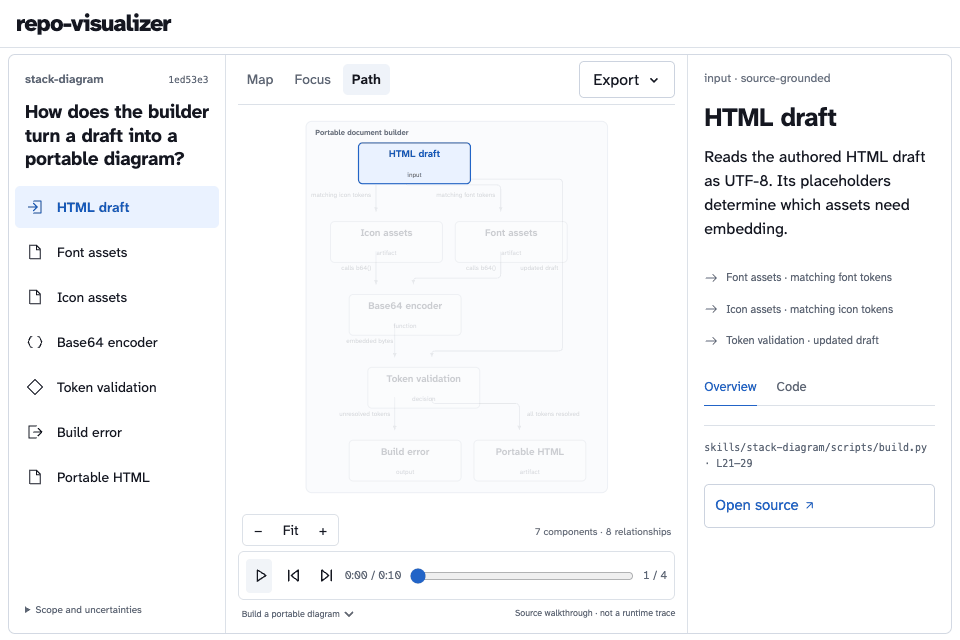

<div align="center">

# Repo Visualizer

**Understand the mechanism behind the code.**

An open skill that turns repository questions into component graphs—with source you can inspect and animations you can share.

[Explore the live demo](https://honzacuhel.github.io/repo-visualizer/) · [Install the skill](#install) · [Download a release](https://github.com/HonzaCuhel/repo-visualizer/releases)

[](https://github.com/HonzaCuhel/repo-visualizer/actions/workflows/check.yml)
[](https://github.com/HonzaCuhel/repo-visualizer/releases)
[](LICENSE)

English · [Česky](README.cs.md)

</div>

<picture>
  <source media="(prefers-color-scheme: dark)" srcset="site/media/walkthrough-dark.gif">
  
</picture>

The agent reads the implementation and authors a graph of responsibilities and relationships. The explorer renders that graph: branches stay branches, retries stay loops, and an optional walkthrough highlights a path through the same topology.

## Install

Run inside your repository:

```sh
npx skills add HonzaCuhel/repo-visualizer --skill repo-visualizer -a codex -a claude-code
```

Keep one `-a` option to choose a single agent. Add `-g` for a personal installation across projects. The installer uses the existing [skills CLI](https://github.com/vercel-labs/skills); skills are fetched from this GitHub repository.

Then ask:

> Use repo-visualizer to explain how this feature works. Extract its components and relationships, include failure paths, and export an interactive HTML graph and a short GIF.

Prefer a file? Download the complete skill ZIP from [Releases](https://github.com/HonzaCuhel/repo-visualizer/releases). Each release includes its SHA-256 checksum. Keep the skill folder intact when installing manually.

| Requirement | Used for |
| --- | --- |
| Codex or Claude Code | Read the repository and author the explanation |
| Node.js 22.20+ | Install through `npx skills` |
| Python 3.9+ | Inventory, source validation and HTML assembly |
| Optional rendering environment | Animated and image exports; see the [export guide](skills/repo-visualizer/references/exports.md) |

## Explore the code, at your own pace

| View | What it shows |
| --- | --- |
| **Map** | The complete component graph, including branches, cycles, parallel edges and nested groups |
| **Focus** | The selected component and its immediate relationships |
| **Path** | A source-derived walkthrough over the same graph |

Select a component or relationship to read embedded code excerpts and open revision-pinned source links. Search, zoom, pan, seek and keyboard controls work in the portable HTML, including offline.

[Explore Codex shell execution](https://honzacuhel.github.io/repo-visualizer/codex-shell.html) · [See the complete agent loop](https://honzacuhel.github.io/repo-visualizer/codex-agent-loop.html) · [Explore the builder example](https://honzacuhel.github.io/repo-visualizer/portable-builder.html)

## One graph, multiple outputs

**Interactive HTML · JSON · SVG · PNG · GIF · MP4 · WebM**

The player and local exporters use the same graph and seekable scene. HTML keeps clickable evidence. Image and video exports carry the visual explanation. An optional [HyperFrames adapter](skills/repo-visualizer/references/exports.md#hyperframes) renders that same scene locally.

Light, dark and system appearance are user choices. Explanations follow the user's requested language, independently of the agent. English and Czech interface translations are bundled; other languages can provide an explicit translated dictionary. [Language and appearance](skills/repo-visualizer/references/localization.md).

## How it stays grounded

1. **Read.** Inventory the repository without importing or running its code; inspect the relevant implementation.
2. **Model.** Describe responsibilities, typed relationships, uncertainty and optional walkthroughs in canonical JSON.
3. **Verify.** Check source ranges, fingerprints and revision before assembling the explorer.
4. **Share.** Inspect the result, then export the same explanation in the format you need.

The semantic explanation is authored by the coding agent. Static imports are hints; matching a fingerprint does **not** prove the interpretation is correct. A walkthrough illustrates source-derived behavior, not a recorded execution.

Generated HTML embeds source excerpts. Keep private-repository artifacts private. The renderer and exports run locally; your coding agent's existing data settings still apply.

## Verification

Fresh Codex and Claude Code sessions have independently produced graphs, offline HTML and changing GIFs from public source. Separate checks cover source fingerprints, graph interaction, packaging, topology, offline operation and decoded video frames. [Test record and limitations](docs/verification.md).

On macOS, the agent's OS sandbox may require approval for the specific trusted browser export command. Dense diagrams are best explored in HTML with zoom; scope a video around one useful question.

## Development

```sh
python3 -m unittest discover -s tests -v
uv sync --locked --extra export
python3 scripts/build_site.py
python3 scripts/package_skill.py
```

Set `REPO_VISUALIZER_BROWSER` to an existing Chromium executable to include browser integration checks. The optional export environment uses Python 3.10+. See the [skill instructions](skills/repo-visualizer/SKILL.md), [graph format](skills/repo-visualizer/references/graph-format.md) and [export guide](skills/repo-visualizer/references/exports.md).

## Credits and license

The main example analyzes [openai/codex](https://github.com/openai/codex) at a pinned revision. Its Apache-2.0 license and NOTICE are retained with the embedded excerpts. [Source and test record](examples/codex/README.md).

Inspired by [caru-ini/stack-diagram](https://github.com/caru-ini/stack-diagram). Additional builder examples analyze its MIT-licensed source at a pinned revision and retain attribution.

Original code is **MIT**. Vendored ELK is **EPL-2.0**, gifenc is **MIT**, and Atkinson Hyperlegible Next is **OFL-1.1**. Full licenses and provenance ship with the skill. [Third-party notices](skills/repo-visualizer/NOTICE.md).
